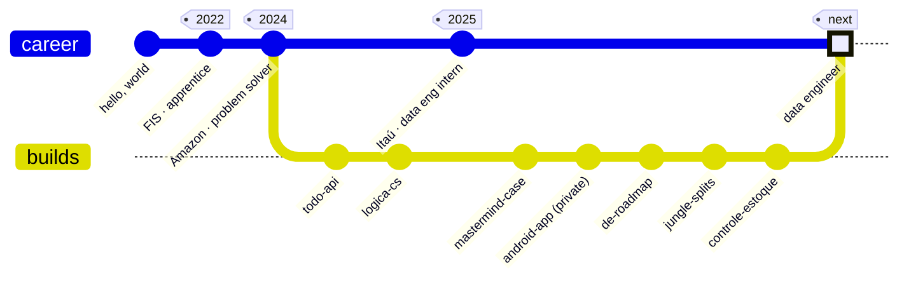
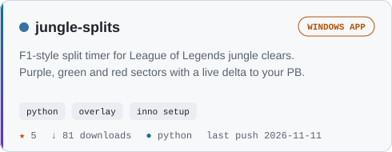
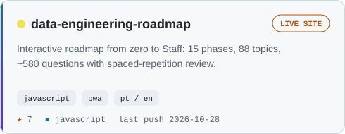
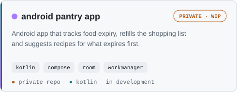

<a href="https://www.linkedin.com/in/juliosantos01/">
  <picture>
    <source media="(prefers-color-scheme: dark)" srcset="assets/header-dark.svg">
    
  </picture>
</a>

<p align="center">
  <a href="https://www.linkedin.com/in/juliosantos01/"></a>
  <a href="https://thiscesarr.github.io/data-engineering-roadmap/"></a>
  <a href="https://github.com/Thiscesarr/jungle-splits/releases/latest"></a>
  
</p>

### `julio=> SELECT * FROM engineer WHERE github = 'Thiscesarr';`

```
-[ RECORD 1 ]-+------------------------------------------------------------
name          | Julio Cesar Santos
role          | Data Engineering & Analytics intern @ Itaú Unibanco
day_to_day    | credit-recovery decision rules in high-volume systems,
              | Python + SQL batch simulations, AWS (Athena, S3, Lambda)
education     | Data Science
studying      | Spark · Airflow · dbt · Kafka  -> tracked in my own roadmap
goal          | become a data engineer one day
side_quest    | built an F1-style timer to speedrun League of Legends clears

(1 row)
```

<details>
<summary><b>🇧🇷 Em português</b></summary>
<br>

Sou estagiário de **Data Engineering & Analytics no Itaú Unibanco**, onde implemento e mantenho regras de decisão de crédito para recuperação de pessoas físicas, com Python, SQL e AWS. Estudo Ciência de Dados e meu objetivo é me tornar engenheiro de dados um dia. Gosto de construir ferramentas que as pessoas realmente usam: um roadmap de estudos com revisão espaçada, um cronômetro para treinar jungle no LoL e um app Android para não desperdiçar comida.

</details>

---

### `$ git log --graph career`



Admin apprentice at FIS → solving inbound problems with global teams at Amazon → turning credit-recovery policies into automated, auditable decisions at Itaú. Every step on the side branch shipped something.

---

### `$ ls ./featured`

<p>
  <a href="https://github.com/Thiscesarr/jungle-splits"><picture><source media="(prefers-color-scheme: dark)" srcset="assets/card-jungle-splits-dark.svg"></picture></a>
  <a href="https://github.com/Thiscesarr/data-engineering-roadmap"><picture><source media="(prefers-color-scheme: dark)" srcset="assets/card-data-engineering-roadmap-dark.svg"></picture></a>
</p>

### `$ ls ./lab` <sub>🔒 private, in progress</sub>

<p>
  <picture><source media="(prefers-color-scheme: dark)" srcset="assets/card-android-pantry-app-dark.svg"></picture>
</p>

<details>
<summary><code>ls -a</code> · more builds and interview cases</summary>
<br>

| repo | what it is | stack |
|---|---|---|
| [controle-estoque](https://github.com/Thiscesarr/controle-estoque) | Interview case: inventory REST API with reservations and holds that stays consistent under concurrent requests | Python · FastAPI · pytest · Hypothesis · CI |
| [mastermind-case](https://github.com/Thiscesarr/mastermind-case) | Interview case: web version of the Mastermind logic game with auth, saved matches and ranking | Java · Spring Boot · Angular |
| [todo-api](https://github.com/Thiscesarr/todo-api) | RESTful task manager with validation, global error handling and Swagger docs | Java · Spring Boot · PostgreSQL · JUnit |
| [logica-cs](https://github.com/Thiscesarr/logica-cs) | Truth-table generator for my Mathematical Logic class, [live on Vercel](https://logica-cs.vercel.app/) | Python · Flask · SymPy |

</details>

---

### `$ cat stack.yml`

Every tool here is tied to where I actually used it.

| stage | tools | used in |
|---|---|---|
| **query** |  | credit-decision audits at Itaú · `todo-api` · `mastermind-case` |
| **code** |  | batch simulations and tests at Itaú · every repo above |
| **cloud** |  | Athena, S3, Lambda and Glue for ingestion and monitoring at Itaú |
| **mobile** |  | native Android app with Jetpack Compose, Room and WorkManager (private, in the lab) |
| **serve** |  | `controle-estoque` · `mastermind-case` · `todo-api` · `logica-cs` |
| **ship** |  | CI on `controle-estoque` · releases on `jungle-splits` · this README |

---

### `$ tail -n 3 pipeline.log`

<picture>
  <source media="(prefers-color-scheme: dark)" srcset="assets/pipeline-dark.svg">
  
</picture>

This profile is a small data pipeline. Every day a <a href=".github/workflows/pipeline.yml">GitHub Action</a> <b>extracts</b> data from the GitHub API, <b>transforms</b> it in plain Python and <b>loads</b> every SVG on this page, in dark and light versions. No third-party stats service, no stale numbers. Source in <a href="pipeline/build.py"><code>pipeline/build.py</code></a>.

---

<p align="center">
  <code>COMMIT;</code> · thanks for reading · <a href="https://www.linkedin.com/in/juliosantos01/">let's talk</a>
</p>
